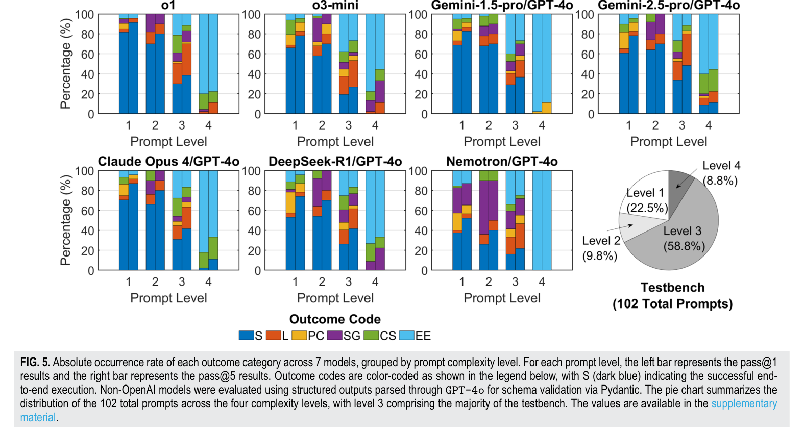
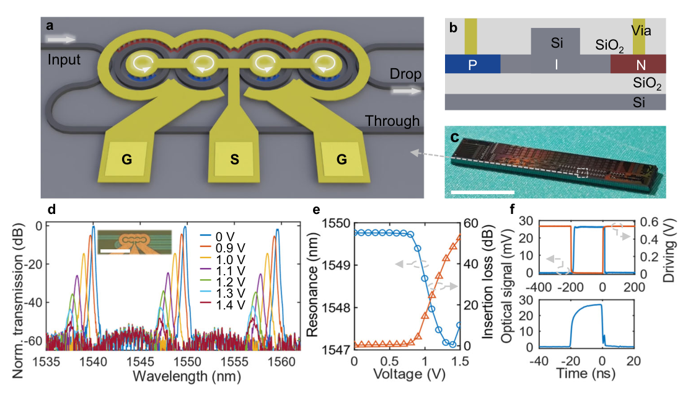
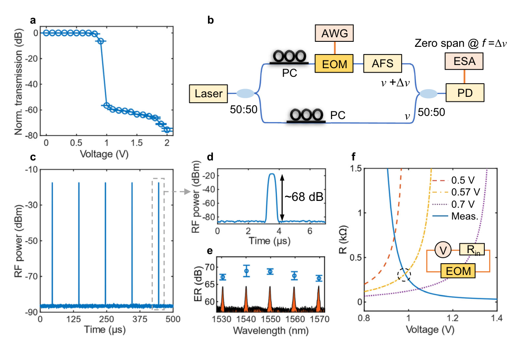

事实源：<code>references/task-016-evidence/README.md</code>。本页为构建时阅读副本。

# TASK-016 调研报告证据增强包

本包只核读既有七篇代表论文，不扩大论文池。每项判断按“结论 → 论文图表 → 数值与条件 → 证据边界”组织。`AUTHOR CLAIM` 表示论文作者报告的实验或仿真结果；本项目没有复算、运行仿真或重复实验。`FACT` 仅用于可直接核对的论文结构、方法描述、图表和引用信息。PDF 页码从文件首页起算，与期刊印刷页码可能不同。

## 证据总览

| 代表工作与核心判断 | 原文图表定位 | 支撑范围与边界 |
|---|---|---|
| [Sharma 等，2025，PhIDO](https://doi.org/10.1063/5.0300741)：自然语言可进入研究级 PIC 结构生成流程 | Fig. 1，PDF p.3；Fig. 5，PDF p.8；Table II，PDF p.9 | 102 个 prompt 的结构成功评价，不能推出性能达标或代工签核。 |
| [Jiang 等，2026，PICopilot](https://doi.org/10.48550/arXiv.2608.01791)：领域 RAG 与分工 Agent 改善 PIC 脚本生成 | Fig. 2，PDF p.3；Table 2/3，PDF p.7；§3.6，PDF p.6 | 内部反馈为静态检查与 LLM 评价；benchmark 另执行脚本并与参考输出比较。不是内部电磁仿真反馈循环。 |
| [Kharel 等，2026](https://doi.org/10.48550/arXiv.2606.00915)：显式约束和数值求解器支持设计迭代 | Fig. 1，PDF p.3；Fig. 2–6，PDF p.5–10；Table S2/S3，PDF p.20 | 设计目标、约束、初始脚本和评价器由人提供；多物理案例先由专家修正设置。结果是论文仿真，不是流片实测。 |
| [Jin 等，2024](https://doi.org/10.1364/PRJ.512298)：SOI PIC 进入真实 DAS 收发链路 | Fig. 1，PDF p.3；Fig. 3，PDF p.5；Fig. 5/6，PDF p.6/7 | 片上为 MZM、偏振处理、相干混合和探测；激光、放大、环行、TIA/DAQ/DSP 等仍片外。原始数据未公开。 |
| [Cheng 等，2023](https://doi.org/10.1038/s41467-023-43244-9)：四微环器件为 DAS 发射端提供高动态消光比 | Fig. 1，PDF p.2；Fig. 2，PDF p.3；Fig. 4/5，PDF p.5/6 | 68 dB 和 3.60 mW 属于该 EOM、特定驱动和测量口径；2 km DAS 为子模块替换对照。 |
| [Sandmann 等，2023](https://doi.org/10.48550/arXiv.2306.04199)：通信相干收发模块可复用于 CC-OTDR 声学演示 | Fig. 2，PDF p.2；Fig. 5，PDF p.4 | 20 km 后端的 200 Hz 扬声器实验是 proof of concept；外部窄线宽激光、EDFA、环行器及离线处理不可省略。 |
| [Ahmed 等，2025](https://doi.org/10.1038/s41586-025-08854-x)：光子张量核与数字控制共同执行多种 AI 任务 | Fig. 1/2，PDF p.2/3；Table 1，PDF p.6；Methods，PDF p.8 | 线性矩阵乘法进入光电混合张量核；非线性、累加、存储、调度仍在电子系统。65.5 TOPS 与任务准确率需分别报告。 |

## Agentic PIC Design：三条不同证据链

### PhIDO：自然语言到结构有效的 PIC 版图

**核心判断。** Fig. 1 的四段是 interpreter → designer → layout → circuit verification，其中前两段由 LLM Agent 承担，后两段主要由算法模块与 CAD/电路工具承担。用户可以在阶段间检查和修改输出。论文的主评价目标是结构有效，不是器件性能。来源：Sharma 等，2025，*AI agents for photonic integrated circuit design automation*，Fig. 1，DOI [10.1063/5.0300741](https://doi.org/10.1063/5.0300741)，PDF p.3，§II。

*Source: Sharma et al., 2025, Fig. 5, DOI: 10.1063/5.0300741；PDF p.8；按图框裁剪，原始柱形、坐标轴、图例与说明未修改；CC BY 4.0。*

| 关键数据 | 条件与原文定位 | 证据等级 |
|---|---|---|
| 102 个设计描述；level 1/2/3/4 为 23/10/60/9 个 | 四级复杂度，含单器件至最多 112 元件；§III.A、Fig. 5，PDF p.6/8 | `FACT`：benchmark 构成 |
| 7 个 LLM，每模型每 prompt 5 次，共 510 次 | interpreter 用 build-from-scratch 模式，后续无人干预；§III.C，PDF p.8 | `FACT`：评价设置 |
| 单器件成功率最高 91%；levels 1–3 的最高汇总 pass@5 为 58%（Gemini-2.5-pro） | 91% 为摘要“up to”；58% 不包括 level 4；Fig. 5、§IV.A，PDF p.8–9 | `AUTHOR CLAIM` |
| level 3 各模型端到端 pass@5 均低于 48%；level 4 仅少数尝试推进到后段 | §IV.A，PDF p.9；Fig. 5 原图展示按等级变化，不把图形目测值当精确表格值 | `AUTHOR CLAIM` |

**“成功”的原文定义。** Table II 的 `S` 是整条流程无致命错误，得到有效 schematic 与 GDSII layout；`EE/CS/SG/PC/L` 分别定位实体提取、器件选择、原理图、参数、版图失败。文中还描述 GDSFactory 路由、DRC 和 SAX 电路仿真；该 benchmark 的 `S` 定义并未要求目标光学性能达到规格。`FACT`：Table II，PDF p.9；§II.E，PDF p.6。作者自称 proof of concept，指出 routing 对交叉或密集互联有限制、性能资格验证尚属未来工作；摘要与§V，PDF p.1/12。作者对非 OpenAI 模型引入 GPT-4o 结构化输出校验，跨模型结果不是完全独立模型能力比较；§II.B、Fig. 5 注，PDF p.4/8。

### PICopilot：脚本生成及评价边界

**核心判断。** Fig. 2 展示 Task Planner → 功能专用生成 Agent（手册 RAG）→ Script Synthesizer → Script Evaluator。Evaluator 在**生成循环内部**使用静态代码检查、自定义检查库和 LLM，原文明确说逐次运行 PIC 工具过于耗时，因而未把直接执行作为内部反馈。来源：Jiang 等，2026，*PICopilot: An LLM-based Agentic Framework for Assisting Photonic Integrated Circuit Design via Script Generation*，Fig. 2、§3.6，DOI [10.48550/arXiv.2608.01791](https://doi.org/10.48550/arXiv.2608.01791)，PDF p.3/6。

*PICopilot Fig. 2 原图请由 DOI 或本地 Zotero PDF p.3 查看；本网页不再分发该图。*

*Source: Jiang et al., 2026, Fig. 2, DOI: 10.48550/arXiv.2608.01791；PDF p.3；网页仅保留原文定位，图片再分发许可未核实。*

| 关键数据 | 条件与原文定位 | 证据等级 |
|---|---|---|
| 48 项：Basic 12、Medium 12、Advanced 24 | 单域小于 10 行、单域 10–50 行、多域大于 50 行核心代码；Table 3，PDF p.7 | `FACT`：benchmark 构成 |
| 15 次独立生成/任务；`#Solved=48` | 脚本**在 benchmark 评分阶段执行**；输出需与设计师已运行的 ground truth 功能一致；每任务至少 3/15 次成功才算 solved；§4.1.3–4.1.4、Table 2，PDF p.7 | `AUTHOR CLAIM`：完成数；`FACT`：判据 |
| Total pass@1 93.9%、pass@5 99.9% | 作者定义的 48 脚本任务、15 次采样的统计；Table 2，PDF p.7 | `AUTHOR CLAIM` |

**证据边界。** benchmark 执行生成脚本用于外部评分，不能倒推内部 Agent 通过真实电磁结果做迭代；FDTD 脚本可运行、参考输出相符，也不等于优化后的器件已满足一套独立物理规格。原文没有形成 PDK/工艺角/流片签核结果，也未由本项目核验公开实现。`INFERENCE`：由 §3.6、§4.1.4 与任务定义联合限定。

### Kharel：显式规则和数值反馈中的设计循环

**核心判断。** 工程师提供问题说明、性能目标、可编辑仿真文件、几何/工艺约束、DRC 程序与评价器；Agent 修改候选，先过规则，调用求解器，读取数值结果并按 acceptance criteria 保留或回退。Fig. 1 是流程，Fig. 2–6 是各案例的原始结果。来源：Kharel 等，2026，*Autonomous agentic design for photonics*，Fig. 1–6，DOI [10.48550/arXiv.2606.00915](https://doi.org/10.48550/arXiv.2606.00915)，PDF p.3–10，§2–3。

*Kharel Fig. 2 原图请由 DOI 或本地 Zotero PDF p.5 查看；本网页不再分发该图。*

*Source: Kharel et al., 2026, Fig. 2, DOI: 10.48550/arXiv.2606.00915；PDF p.5；网页仅保留原文定位，图片再分发许可未核实。*

| 案例与结果 | 求解器、条件、验收信息及定位 | 证据等级 |
|---|---|---|
| SiN 12 µm 半径弯曲：圆弧基线 0.460 dB → 最优 0.109 dB，97.51% 基模透射 | 400 nm SiN、SiO₂ 包层、1550 nm、150 nm 最小特征、50 次仿真预算；Fig. 2、§S2.1，PDF p.4–5/12–14 | `AUTHOR CLAIM` |
| MRM PN 结：39 次迭代，最优 VπL=0.53 V·cm、Cj=0.83 pF/mm | 五个反向偏置点的 drift-diffusion 与光学模态计算；100 nm 以下掺杂条、浮置区域及耗尽区与光模不交叠被规则拦截；Fig. 3、§S3.1，PDF p.6/15 | `AUTHOR CLAIM` |
| RF 电极：45 次迭代，Z₀≈43–44 Ω、α₀≈0.29–0.36 dB·cm⁻¹·GHz⁻¹ᐟ² | 5–45 GHz 3D RF 仿真；目标含 50 Ω 与速度匹配；100 nm 最小金属特征等规则；Fig. 4、§S4，PDF p.7–8/16 | `AUTHOR CLAIM` |
| 电路布线：192 → 0 个 DRC violation，27 次迭代 | 32 接点到 32 焊盘；规则统计加热器穿越、线间交叉等；Fig. 5、§S5，PDF p.9/18 | `AUTHOR CLAIM` |
| 多物理 MZM：9 个设计，约 29–40 GHz 3 dB EO 带宽 | 在专家修正 mode 识别、结电容重复计数等初始设置之后，200 次 FDTD 上限；Fig. 6、Table S2/S3，PDF p.10/19–20 | `AUTHOR CLAIM` |

**必须保留的反例。** 多物理 MZM 首次自治设置在 30 GHz 给出 Z₀≈14.7–14.8 Ω，而原论文参考值为 48 Ω；工程师修正了模态识别与 junction shunt 处理，并增加其他设置后才启动后续设计循环。Table S2，PDF p.20。该论文支持“Agent 能在显式规则与求解器反馈下执行有价值的探索，并可记录假设和拓扑切换”；无法单凭结果证明 Agent 已独立建立正确物理模型、自动设定验收条件，或完成实物验证。`AUTHOR CLAIM`＋`INFERENCE`。

## DAS：集成功能、外部依赖和系统指标

### Jin 2024：系统级光路的片上/片外划分

**核心判断。** Fig. 1(b) 的 SOI 芯片含 MZM 发射、PC/BS、PBRS、1×2 MMI、两组 90° hybrid 和四个平衡光电探测器；Fig. 3 的系统另有窄线宽激光、EDFA、环行器、AWG、TIA、DAQ、计算机/DSP 与传感光纤。Fig. 5/6 才是下面指标的实测定位。来源：Jin 等，2024，*Silicon photonic integrated interrogator for fiber-optic distributed acoustic sensing*，Fig. 1/3/5/6，DOI [10.1364/PRJ.512298](https://doi.org/10.1364/PRJ.512298)，PDF p.3/5/6/7。

| 系统指标 | 条件与原文定位 | 证据等级 |
|---|---|---|
| 12.1 km 光纤：1.14 m 空间分辨率、59 pε/√Hz 应变分辨率 | 100 Hz PZT、5 kHz 脉冲重复率、0.819 m gauge length、300 相邻轨迹；Fig. 5、§4.B，PDF p.5–6 | `AUTHOR CLAIM` |
| 49.0 km 光纤：3.78 m 空间分辨率、81 pε/√Hz 应变分辨率 | 100 Hz PZT、1.5 kHz 重复率、4.01 m gauge length、120 相邻轨迹；Fig. 6、§4.B，PDF p.6–7 | `AUTHOR CLAIM` |

**边界。** 芯片进入真实传感链路，不等于完整 DAS 仪器集成；论文明确说光源、光放大器和环行器未集成，底层数据当时未公开。§5 与 Data Availability，PDF p.7–8。由于两组光纤长度、gauge length 和重复率不同，不把 59 与 81 pε/√Hz 当成单变量比较。

### Cheng 2023：面向 DAS 发射脉冲的四微环结构

**核心判断。** 四枚 10 µm 半径耦合微环与 PIN 注入区形成窄通带和陡边；Fig. 1(d) 是随偏压变化的原始 transmission spectrum，Fig. 2(c–e) 是高动态 ER 的测量，Fig. 4/5 才证明器件替换进入 2 km DAS 台架。来源：Cheng 等，2023，*On-chip silicon electro-optical modulator with ultra-high extinction ratio for fiber-optic distributed acoustic sensing*，Fig. 1/2/4/5，DOI [10.1038/s41467-023-43244-9](https://doi.org/10.1038/s41467-023-43244-9)，PDF p.2–6。

*Source: Cheng et al., 2023, Fig. 1(a–f), DOI: 10.1038/s41467-023-43244-9；PDF p.2；只裁去正文与原图题注，坐标轴和图例保留；CC BY 4.0。*

*Source: Cheng et al., 2023, Fig. 2(a–f), DOI: 10.1038/s41467-023-43244-9；PDF p.3；只裁去正文与原图题注，坐标轴和图例保留；CC BY 4.0。*

| 器件/系统指标 | 条件与原文定位 | 证据等级 |
|---|---|---|
| 静态 transmission contrast 71 dB；动态 ER 68 dB | 静态 1549.74 nm、约 1.9 V；动态 self-heterodyne，五相邻通道均 >65 dB；Fig. 2、PDF p.3–4 | `AUTHOR CLAIM` |
| EOM 功耗 3.60 mW；上升/下降 6.54/0.40 ns | 高占空比脉冲驱动，实际器件电压约 0.99 V、电流 3.65 mA；6 GHz 示波器的 10–90% 边沿定义；Fig. 1(f)、Fig. 2(f)，PDF p.3–4 | `AUTHOR CLAIM` |
| 2 km DAS，4 pε/√Hz 噪声等效应变；500 Hz 声学信号 | Φ-OTDR 与商用 AOM 的其余配置相同；Fig. 4/5，PDF p.5–6 | `AUTHOR CLAIM` |

**边界。** 3.60 mW 是调制器本体电耗，不是激光、EDFA、探测和数据处理的全系统功耗。作者指出温度敏感、硅的非线性吸收及约 6.5 ns 响应会限制部分更短脉冲场景；§Discussion，PDF p.6。不能从器件高 ER 推出完整 DAS 收发 PIC 已实现。

### Sandmann 2023：通信收发模块复用

Fig. 2 将 IC-TROSA 纳入 CC-OTDR；其片内/封装有双偏振 IQ 调制、相干接收、探测与 TIA，片外仍有 <100 Hz 线宽激光、EDFA、滤波、环行器、示波器与离线相关处理。Fig. 5 在 **20 km launch fiber 之后**对一段光纤施加 200 Hz 扬声器信号，测得约 0.9 rad 峰峰相位变化；3.5 kHz 序列重复率对应最高 1.75 kHz 动态事件带宽。`AUTHOR CLAIM`：§III、Fig. 2/5，PDF p.2–4。来源：Sandmann 等，2023，*Acoustic Sensing with Correlation and Coherent Detection using an Integrated Coherent Transceiver*，DOI [10.48550/arXiv.2306.04199](https://doi.org/10.48550/arXiv.2306.04199)。本地会议 PDF 有 IEEE/VDE 授权限制，未将原图复制进公开仓库；需在本机 PDF p.2/4 查看原图。

## Photonic AI Computing：Ahmed 2025 系统层证据

**核心判断。** Fig. 2(a–c) 清楚分开 host/PCIe、数字控制接口 DCI、数据转换、PTC 与输出流水线。PTC 执行 128×128 矩阵向量乘法中的光电混合乘加；权重存储、编译与调度、数据转换、非线性、累加等仍由数字与电子部分完成。来源：Ahmed 等，2025，*Universal photonic artificial intelligence acceleration*，Fig. 1/2，DOI [10.1038/s41586-025-08854-x](https://doi.org/10.1038/s41586-025-08854-x)，PDF p.2–3。Nature PDF 标注独家许可，本包不再分发原图；原图从 Zotero PDF p.3 或 DOI 页面查看。

| 指标 | 条件与原文定位 | 证据等级 |
|---|---|---|
| 4 个 128×128 PTC + 2 个 DCI；65.5×10¹² ABFP16 ops/s | 主文所述 500 MHz 可运行口径；78 W 电子功率、1.6 W 光功率；Fig. 1/2、PDF p.1–3/6 | `AUTHOR CLAIM` |
| ResNet18 CIFAR-10：86.4%（FP32 88.3%）；BERT-Tiny IMDb：83.2%（FP32 86.2%） | 同模型权重/输入；Table 1，PDF p.6 | `AUTHOR CLAIM` |
| BERT-Tiny SQuAD F1：12.0（FP32 43.5）；ImageWoof：79.7%（FP32 84.2%） | Table 1；ImageWoof 有专门重新训练，其余模型作者称未重新训练；PDF p.6 | `AUTHOR CLAIM` |
| 2 GHz 对应 262×10¹² ops/s | 论文注明此时有 intermittent errors；不是任务级可靠吞吐；§AI workload execution，PDF p.6 | `AUTHOR CLAIM` |

**能耗边界。** 论文报告单 PTC 3.2 W、DCI 65 W，主文约 78 W 电子功率；Methods 另列八只激光器每只 1.25 W 电功率、200 mW 光输出，PDF p.6/8。**全卡墙插功耗与统一任务级 energy/inference 在现有主文页中不能确定**，不能把 65.5 TOPS/78 W 直接写成完整 AI 系统能效。`INFERENCE`。这篇展示的是多种模型的实际运行，但任务表现差异大，尤其 BERT-Tiny SQuAD 与强化学习任务。

## 与当前研究问题的收敛

问题仍为：**AI 如何理解真实的 PIC 设计需求与物理约束？** 以下是按原文实现层级的对照，不是“Agent 是否理解物理”的心理判断。

| 能力层 | PhIDO | PICopilot | Kharel | 本轮可以推出什么 |
|---|---|---|---|---|
| 自然语言需求解析 | 实体、连接、参数解析 | 脚本任务分解与改写 | 人类给定问题说明后由 Agent 操作 | 三者均处理文本任务，但输入和输出对象不同。 |
| 知识/RAG | 模板、PDK 描述检索 | 工具手册多库检索 | 论文阅读和运行日志 | 知识来源不等于物理正确性的独立判据。 |
| 显式规则与 PDK | schema、PDK 组件与路由/DRC | 静态代码检查与自定义检查库 | 最小特征、几何、工艺和物理一致性 DRC | Kharel 对可编码约束给出最具体的数值仿真前闸门。 |
| 数值反馈 | SAX 电路模型；性能资格非主目标 | 内部评价器未直接运行 PIC 工具；benchmark 外部执行脚本 | 多物理求解器的数值结果驱动保留/回退 | 不能把脚本通过外部评分与 Agent 内部仿真反馈视为同一层。 |
| Acceptance criteria | benchmark 的有效 schematic/GDS | 参考输出功能一致且至少 3/15 次成功 | 工程师提供定量指标及约束 | 判据是谁提出、位于哪一层，比“闭环”标签更关键。 |
| Agent 自主推理 | 生成设计候选 | 分解、检索、生成和静态修正 | 提假设、切换结构、读取求解器与日志 | 可观察行动支持“规划/修正”；独立建立正确物理模型仍需单独验证。 |

**本轮新增判断（`INFERENCE`）。** 研究空间应更具体地表述为：复杂设计需求如何形成**可检查的约束**，在跨工具表示与数值反馈中保持一致，并在初始设置错误或目标冲突时被发现；不能笼统称已有 Agent“不理解物理”。依据：PhIDO Table II/§II.E，PICopilot §3.6/§4.1.4，Kharel §2/§S6。

## 未解决与 UNKNOWN

1. PhIDO Fig. 5 的逐模型、逐等级精确百分比在论文主文写明见 supplementary；本轮未拿到可核对的原始数值表，因此只引用正文明确数值，不从柱形图读出伪精度。
2. PICopilot 的公开实现、完整 48 任务脚本与原始运行日志未由本项目核验；其脚本执行结果无法在本项目独立重算。
3. Kharel 各求解器输出的原始网格/收敛日志、加工后实测及跨 PDK 迁移成功率未由本轮验证；多物理初始设置依赖专家修正。
4. Jin 2024 系统原始波形/数据未公开；片外设备的完整功耗、体积和成本无统一统计。
5. Sandmann 的系统检测限、空间分辨率与跨条件重复统计，本轮会议短文没有提供足够口径用于与 Jin 数字直接对比。
6. Ahmed 的统一墙插功耗、各 workload 的 energy/inference 与可靠吞吐未从当前 Zotero 主文 PDF 完整核实；补充材料尚未核读。Nature 原图许可不支持本包再分发。
7. Jin、Sandmann、Ahmed 原图不复制进公开仓库；若需在可公开发布的 PPT 或报告中直接重用，应核实许可或取得授权。Kharel/PICopilot 既有局部原图也需在再发布前核权利。

`figure-sources.md` 记录各图号、PDF 页码、裁剪方式与许可；`key-data.csv` 可机器检索每项数值和条件；`agentic-pic-comparison.md` 是本轮要求的八列比较表；`evidence-log.md` 将新增判断逐条连回原文。所有本地 PDF 的 SHA-256 见 `source-manifest.md`。
