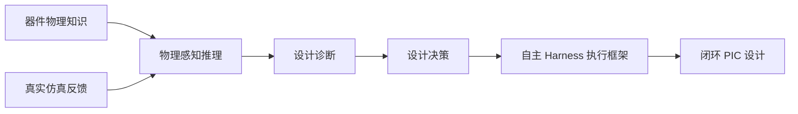
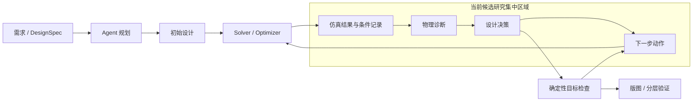
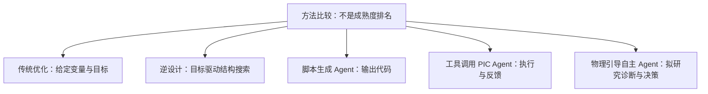

# 候选研究方向：物理驱动的自主光子芯片设计

**Physics-guided Autonomous PIC Design（物理驱动的自主光子芯片设计）**

状态：`USER RESEARCH PREFERENCE / INFERENCE`，2026-09-30 更新。不是最终定题，未证明创新性或有效性；不改变既有证据截止范围。

一句话：研究如何让 PIC Agent 利用器件物理知识和真实仿真反馈进行设计诊断与决策，从“会调用仿真器”进一步发展为“能够根据物理结果自主做设计”。

## 1. 从已有调研得到的问题

- `FACT`（文献内容核读事实）：[PhIDO](https://doi.org/10.1063/5.0300741) Fig. 1 / Table II 的主 benchmark 以结构与 GDS 有效性为成功定义；不能由此推断全波性能达标。
- `FACT`（文献内容核读事实）：[PICopilot](https://doi.org/10.48550/arXiv.2608.01791) §3.6 的内部评价主要是静态代码检查、自定义检查库和 LLM；外部 benchmark 执行评分不等于内部物理仿真迭代。
- `AUTHOR CLAIM`：[Kharel / AutoPhotonicDesign](https://doi.org/10.48550/arXiv.2606.00915) Fig. 1–6 展示规则闸门、真实求解器反馈和定量验收迭代；Table S2 记录多物理初设曾由专家纠错。这是“领域只会生成脚本”的强反例。
- `CODE VERIFIED`：沿用既有 TASK-005 固定范围只读源码记录；**本次未开展新的源码执行核验**，不能赋予新候选方法此标签。
- `INFERENCE`：值得追问的是反馈如何支持可核验的诊断与动作选择，而非预设“所有现有 Agent 均缺少物理推理”。相关证据见[三项目比较](../task-016-evidence/agentic-pic-comparison.md)与[证据日志](../task-016-evidence/evidence-log.md)。

## 2. 候选研究问题

`USER RESEARCH PREFERENCE`：如何结合 PIC 器件物理知识与数值仿真反馈，使 Agent 对设计结果作出可检验的物理诊断、选择合理的下一步修改，并提高自主设计可靠性？

研究重点由“需求理解与物理约束处理”进一步转向**仿真后的结果分析与设计决策**。DesignSpec（结构化设计规范）仍是必要支持层，不自动成为本候选方向的最高层研究问题。物理推理失败与失败恢复均重要，但研究对象不缩减为单独的恢复模块。

### 图 1｜研究主线（拟议概念，不是已实现系统）

## 3. 拟议系统概念：双层分工

`INFERENCE / USER RESEARCH PREFERENCE`：核心方法具有研究深度，Harness 是证明方法价值的系统载体，而非以工具拼接本身宣称科研贡献。

| 层 | 拟议职责 | 正确性边界 |
|---|---|---|
| Agent / Harness（智能体与执行框架） | 目标理解、规划、结果解释、原因诊断、动作选择、工具组织、状态与恢复 | 可提出达标判断，但必须由确定性评价器复核；解释本身不是物理真值 |
| Physics / Numerical（物理与数值） | EM solver（电磁求解器）、器件模型、优化器、参数扫描、确定性验证 | 提供可追溯的数值证据；结果仍取决于材料、网格、边界、模型与收敛条件 |

**LLM 不代替 Maxwell solver（麦克斯韦方程求解器）。** 调用求解器不等于物理正确，单次性能达标不等于工艺签核。

## 4. Physics reasoning（物理推理）在 Harness 中的位置

### 图 2｜完整流程中的研究集中区域

`INFERENCE`：诊断应形成能被下一轮仿真检验的预测，而非仅生成听起来合理的解释；记录输入条件、结果、诊断假设、选择理由和后续反馈，有助于识别错误因果解释。这是候选方法要求，不是已验证增益。

## 5. 与传统优化 / 逆设计的关系

### 图 3｜五种方法的比较框架

下表为概念分析，不是同条件实验结果。传统优化与逆设计有交集；工具调用型 Agent 也可能已经具备物理诊断，不能按名称假定其缺失。

| 方法 | 主要机制（INFERENCE / 概念分类） | 与候选方向的关系 | 当前不能确认 |
|---|---|---|---|
| Traditional Optimization（传统优化） | 给定变量、约束和目标后数值搜索 | 若固定问题可直接优化，可能无需 LLM | 是否需要 Agent 才能解决：UNKNOWN |
| Inverse Design（逆设计） | 从目标性能搜索参数或结构，常用数值优化 | 应被视为可复用底座或强对照，不是被 Agent 替代 | 相同预算下优劣：UNKNOWN |
| Script-generation Agent（脚本生成智能体） | 将需求转为代码；运行反馈因系统而异 | PICopilot 的静态内部评价说明必须核对反馈来源 | 脚本正确能否推出物理正确：不能；普遍诊断能力 UNKNOWN |
| Tool-calling PIC Agent（工具调用型 PIC 智能体） | 调用确定性工具并组织状态；部分已有仿真迭代 | AutoPhotonicDesign 是已有求解器闭环的反例 | 可泛化诊断能力及人工设置依赖：UNKNOWN |
| Physics-guided Autonomous Agent（物理引导自主智能体） | 拟将知识、仿真、诊断和动作选择相结合 | 用户当前候选主线，不是公开成熟实现 | 创新性、有效性、泛化与相对优化的增益均 UNKNOWN |

只有在目标/拓扑切换、多约束冲突、模型有效性诊断或策略选择等环节存在可证明的额外价值，Agent 才可能超出“包装优化器”。这些可能性为 `INFERENCE`，不是研究贡献结论。

## 6. 初步验证思路（非实验执行方案）

`USER RESEARCH PREFERENCE`：基础 PIC 推理覆盖 MMI、MZI、定向耦合器、微环与波导等，关注参数—性能关系、权衡、合理性、结果解释、瓶颈诊断和动作选择；随后考虑 1–2 类器件的真实 simulation-in-the-loop（仿真在环），再讨论复杂 PIC / 系统。

可能比较 Baseline Agent（基线智能体）与 Physics-guided Agent（物理引导智能体），但还应讨论传统优化 / 逆设计对照。设计成功率、迭代数、求解器调用、约束违反、物理无效决策、恢复率和最终 FoM（性能指标）仅为**候选指标**；定义、预算、样本、任务和判据均未确定。本轮没有启动 benchmark、仿真或实验设计细化。

**DAS 当前候选定位**：后续复杂应用与系统级验证场景之一，最终角色仍需导师确认。DAS 和 Photonic AI Computing（光子人工智能计算）原有三方向调研及候选路线不删除、不判为淘汰。

## 7. 三个假设与开放问题

| 假设 | 当前状态 | 必须主动寻找的反例 |
|---|---|---|
| H1：现有 PIC Agent 是否缺少物理诊断与决策？ | UNKNOWN；不能以没有单独命名模块推断没有能力 | AutoPhotonicDesign 已利用仿真反馈、可换策略；需区分已有行为与通用诊断证据 |
| H2：物理引导推理能否改善设计与可靠性？ | UNKNOWN；尚无本项目对照结果 | 普通工具反馈或同预算优化已足够；增加推理反而耗时或产生错误解释 |
| H3：相对优化 / 逆设计，Agent 增加什么价值？ | UNKNOWN；是本方向成立的关键 | 固定变量与目标可直接优化；Agent 仅调用同一优化器而无额外贡献 |

## 8. 当前证据缺口

1. 缺乏本候选方法与现有系统的逐能力差异证据，不能宣称首次解决物理诊断。
2. 缺少同工具、预算和信息条件下的比较，不能宣称可靠性或效率增益。
3. 缺少诊断预测与后续仿真结果的一致性证据；“解释正确”不自动意味着“决策正确”。
4. 缺少跨器件、工艺、模型和任务的迁移证据。
5. 没有本项目制造、全系统 DAS、PDK 签核或实验结果；仿真结论不能越级外推。

## 9. 最强反驳、风险与更简单替代

- **已有能力反例**：AutoPhotonicDesign 已展示定量反馈与自主迭代；若其已有诊断/策略选择足够，本方向创新空间可能很窄。专家修正说明条件边界，不证明所有诊断均缺失。
- **数值优化反例**：固定目标下成熟优化更直接、确定且成本更低；必要时优先采用规则、参数扫描或优化器，而非增加 Agent。
- **错误因果风险**：Agent 的物理故事可能与真实失败原因无关；仿真设置错误还会让反馈“有数值但不可信”。
- **评价偏差风险**：同一 LLM 生成与评判诊断，或只选择成功案例，均可能虚高结果；具体评价设计尚未确定。
- **机会成本**：通用 Harness、领域知识、复杂 DAS 和方法研究同时扩张会分散精力。候选系统边界需收敛，不能承诺硕士阶段完成通用端到端签核。

上述风险为 `INFERENCE`；基于现有证据的审查不等于已经否定或确认候选方向。

## 10. 需要导师确认

- 核心研究问题应聚焦哪种诊断与决策，如何与已有优化工作形成实质差异？
- 本候选主线是否值得继续核验，DAS 是主任务还是后续复杂应用之一？
- 基础器件覆盖、方法深度与 Harness 系统边界如何取舍？
- 哪些假设应先补文献证据，哪些将来才需要实证？

原有[三条候选路线](candidate-routes-and-open-questions.md)与[正式报告第六章](formal-research-report.md#第六章-候选研究路线与后续讨论)继续保留。本页是候选方向收敛材料，不授权工程、仿真或最终选题。
