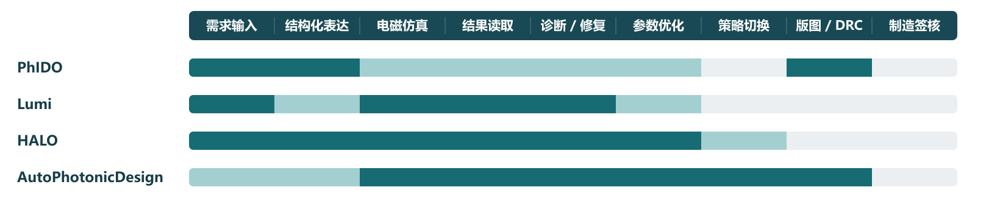

# 第二章｜已有 Agent 设计路径及流程覆盖比较

2026-10-15 修订稿

## 2.1 从完整流程看已有工作

可靠的器件与电路设计涉及需求表达、方案选择、设计建模、工具执行、结果评价与反馈修订。器件层面需要判断结构、材料和性能；电路层面需要选择器件组合、建立连接并评价整体响应。进一步形成芯片时，还涉及版图、路由及相应验证。比较已有工作，应同时看它覆盖哪些环节，以及 Agent 在这些环节中承担什么决策。

图 2-1：四个代表工作的流程覆盖。深色为直接展示，浅色为部分覆盖，灰色为缺失或未核实。出处与具体条件见[证据索引](../evidence-index.md)。

PhIDO 侧重需求到结构化电路和版图；Lumi 侧重仿真脚本执行与修复；HALO 连接结构化建模、电磁求解和反馈修订；AutoPhotonicDesign 展示工程师给定问题后的自主器件优化。这些工作面向不同任务，比较时需要明确各自的输入、评价对象和结果口径。[1–4]

本报告同时考察三类依据如何进入设计：需求是否落实为功能、工作条件和评价目标；物理模型是否支持相应器件或电路判断；已知制造规则是否约束候选方案。它们贯穿方案生成与修订，而不是在性能优化结束后才附加检查。

## 2.2 三种执行路径

按两个维度分析，
1.设计决策自由度：决定 Agent 能选择哪些器件方案、组合与连接、参数、结构和搜索策略；
2.工具执行自由度：决定它能否改变执行顺序、调用方式和底层代码。
HALO中使用三种典型组织方式如下，

| 路径 | 设计决策 | 工具执行 | 主要取舍 |
|---|---|---|---|
| 固定结构化工作流 | Agent 每轮提出设计方案与参数修改 | 检查、仿真、评价按预定步骤执行 | 流程清楚，适合任务和工具已明确的场景；扩展能力依赖工具和设计表示 |
| 自主结构化 Agent | Agent 自主安排分析与中间动作 | 正式求解通过预定义接口执行 | 可以组织诊断与工具组合，同时保持统一执行方式 |
| 自主编码 Agent | Agent 通过代码修改设计和工作过程 | 在项目允许范围内编写、运行和修复脚本 | 扩展灵活，同时增加代码、API、路径和输出格式等错误来源 |

HALO 将这三种方式分别实现为固定 LangGraph 工作流、保留结构化仿真接口的 LangChain DeepAgent，以及直接编写仿真代码的自主 Agent，提供了同一研究框架中的机制比较。[3]

### 固定结构化工作流：执行步骤固定，设计选择可以自主

以波导设计为例，每轮均按“提出设计 → 检查 → 仿真 → 评价”执行，Agent 则根据需求、约束和历史结果选择下一组参数或另一种已支持的结构。固定的是执行步骤，设计选择随反馈变化。对于电路任务，相应设计表示需要能够表达器件选择、端口与连接，以及目标功能。

这种路径适合先将求解器调用、结果读取和约束检查固定下来，把研究集中在 Agent 如何选择修改。若希望调整网格、仿真时长或结构形式，相应内容需要成为工具支持的输入。

### 自主结构化 Agent：自主安排动作，求解器调用保持统一

Agent 可以决定先分析失败记录、检查材料与结构、获取诊断信息，还是继续搜索，然后通过工具执行所选动作。设计和设置以结构化字段传递，执行器负责输入检查、调用求解器和整理产物。

它适合方案选择、约束判断、问题诊断和设计修订需要不同工具组合的场景。工具能力决定 Agent 能实现哪些设计思路：支持新设计家族或器件连接方案，可能需要扩展几何生成器、电路表示或评价工具。

### 自主编码 Agent：通过修改代码扩展能力

自主编码允许 Agent 直接修改建模脚本和执行过程，适合已有接口难以表达的新结构或特殊计算。Lumi 和 AutoPhotonicDesign 提供了脚本执行、反馈修复和迭代设计方面的参考。[2,4]

这一路径把一部分适配工作交给 Agent。研究者需要同时处理代码正确性、工具使用与设计判断，分析失败时也要区分软件错误和器件性能问题。

HALO Table 3 中，Claude Sonnet 4.6 的固定、自主结构化、自主编码配置宏平均成功率分别为 69.1%、68.9% 和 79.8%；固定配置的 token 效率更高。该表每个模型—配置—任务运行一次，宏平均取三个任务组成功率的平均值，内部工作量也不同。它表明自由度、效果与成本存在取舍，不能用自主程度直接替代性能判断。[3]

## 2.3 四个代表工作的实际完成程度

| 工作 | 主要技术路径与工具 | 实际完成的内容 | 对本研究的启发 |
|---|---|---|---|
| [PhIDO](https://doi.org/10.1063/5.0300741) | 自然语言解析、DSL 与组件绑定；gdsfactory、SAX、版图检查 | 形成结构化电路和 GDS；论文主评测关注结构/版图有效性 | 借鉴需求、组件绑定与连接表达，将电路响应评价和版图检查分开分析 |
| [Lumi](https://doi.org/10.1145/3787109.3816402) | 生成脚本、受限工具执行、Lumerical FDTD、反思重试 | 仿真执行、产物归档和错误修复；执行、设置、结果分别评价 | 从执行反馈到修复动作，区分“程序正常运行”与“模型符合需求” |
| [HALO](https://arxiv.org/html/2608.28877v2) | 类型化设计表达、RCWA、诊断评价；三种规划配置 | 形成需求—建模—仿真—修订闭环，以周期纳米光学任务评测 | 比较决策自由度与执行方式，借鉴结构化接口与反馈组织 |
| [AutoPhotonicDesign](https://arxiv.org/html/2606.00915v1) | 通用编码 Agent、Tidy3D 等工具、约束检查、数值 FOM 与日志 | 展示多类器件优化、参数搜索、拓扑切换与布线；波导案例报告 0.460 dB → 0.109 dB | 借鉴约束下的器件方案调整，分析修复、保留/回退与切换依据 |

PhIDO 的结构化电路和组件工具链为器件组合、连接表达提供参照，其 SAX 属于电路模型层；结构或版图有效与目标功能达成需要分别评价。Lumi 的执行修复机制可供借鉴，设置与结果评价则提示我们检查需求和仿真条件。HALO 为执行方式比较提供了统一框架，其 RCWA 任务与导波 PIC 的器件问题应分别理解。[1–3]

AutoPhotonicDesign 是重要的已有能力参照。论文报告 Agent 能从数值反馈中修改假设、切换结构家族，并处理部分仿真基础设施问题；多物理 MZM 案例中，专家还补充了初始设置修正。[4] 第三章会分析这些行为如何支持下一步决策。

## 2.4 与传统优化和逆设计的分工

传统优化、逆设计与 Agent 可以共同参与设计流程。优化器负责在给定变量、约束和目标下搜索参数或结构，求解器负责计算响应，Agent 则可以解释需求、组织方案、分析异常，并选择搜索方式或设计修订动作。制造规则与功能要求作为方案评价的依据。

逆设计也能搜索自由形状。HiLAB 结合部分拓扑优化、变分自编码器与贝叶斯优化，提供了非 Agent 结构搜索的参照。[5] 因此，结构变化或多轮迭代本身不足以说明 Agent 的额外作用。

这部分关注的分工是：Agent 依据需求、约束和反馈判断需要修复模型或仿真设置、调用优化器，还是调整器件结构、组合与连接方案；底层数值方法承担具体计算和搜索。比较时，应看这种协调是否解决了从设计目标到可评价方案的具体困难。

## 2.5 当前比较取向：决策自主，执行受控

结合当前研究问题，我倾向于让 Agent 的自主性主要体现在需求理解、方案选择、指标权衡和反馈决策，把建模、求解器调用、结果读取和规则检查交给稳定工具。固定结构化工作流与受控自主结构化 Agent 都值得继续比较。

初始模型可以由 Agent 复用示例、调用模板或自主建立。设计过程中，Agent 根据需求与反馈提出动作，工具检查输入并执行；网格、仿真时长等设置在预先允许的范围内自主调整，涉及工具扩展或关键建模变化时请专家介入。电路层先纳入器件组合、连接关系和功能/响应评价。

在这一组织方式中，工具提供设计家族、基础几何和器件连接表达能力，Agent 利用这些能力自主探索。新方案需要额外建模或计算能力时，由人参与理解方案、补充程序并检查工具，再交给 Agent 使用。工具扩展可以由 AI 辅助编写，人负责审查；后续方案选择和设计修订仍由 Agent 完成。

流程采用固定主流程与受控动作分支相结合的方式。Agent 根据反馈选择读取日志并修复执行异常、检查模型与仿真设置，或调整参数、器件结构和电路方案；各分支由预先定义的工具执行。Agent 负责选择动作、确定参数，并根据执行结果决定后续步骤。

| Agent 负责选择 | 工具负责执行 | 需要进一步比较的内容 |
|---|---|---|
| 如何将需求落实为设计方案与评价目标 | 校验结构化需求字段、查询可用组件和模型 | 功能目标、工作条件和约束是否明确 |
| 采用哪些器件及连接方案 | 生成器件组合与连接表示，计算电路响应 | 器件接口与模型适用性，组合后的功能表现 |
| 在满足制造约束的候选中如何选择 | 检查给定工艺规则，记录违规项 | 规则来源、适用范围与合规修订依据 |
| 修改哪些设计参数、采用何种搜索方式 | 生成几何、计算性能、运行优化器 | 支持的变量与设计空间、结果可比性 |
| 是否检查或修复仿真设置 | 检查配置、运行求解器、读取日志与产物 | 可调整设置、错误分类与修复后的评价 |
| 是否更换结构形式或设计家族 | 根据设计表示调用相应生成器 | 新结构的表达能力、约束检查与接口扩展 |
| 保留、回退或继续探索哪个方案 | 保存配置、结果与版本，执行回退 | 选择依据与后续结果是否一致 |

### 路径比较的优先级

本报告优先比较自主设计决策能力，其次分析设计推进的可靠性，再考察实现代价。

1. 自主设计决策能力：Agent 能否依据需求和约束选择方案，并利用反馈修复模型、调整参数、改变结构或连接。
2. 设计推进的可靠性：功能、性能与已知制造要求是否共同参与评价；遇到偏差、异常或停滞时，能否依据可核查证据修订方案。
3. 实现代价：需要多少人工介入、工具扩展与计算资源。

据此，路径比较关注哪种组织方式更有助于可靠地自主推进器件与电路设计。当前优先考察固定主流程与受控动作分支的组合，将自主编码作为工具能力不足时的对照路径。

这一取向把自主设计具体化为需求和约束下的一系列方案与动作选择。下一章将集中讨论：Agent 如何从仿真和验证反馈中识别问题，并决定修复模型或设置、继续调参，还是调整器件与电路方案。

## 参考文献与原文定位

1. Sharma 等，PhIDO，[DOI 10.1063/5.0300741](https://doi.org/10.1063/5.0300741)，Fig.1、Table II、§II.E；既有[核读比较](../../task-016-evidence/agentic-pic-comparison.md)。
2. Chen 等，Lumi，[DOI 10.1145/3787109.3816402](https://doi.org/10.1145/3787109.3816402)，用户供给 PDF p.3–5，Fig.1–2、§3、Table 2。
3. Zhang 等，HALO，[arXiv:2608.28877v2](https://arxiv.org/html/2608.28877v2)，Method / Planner Configurations、Common Evaluation Protocol、Table 3。
4. Kharel 等，[Autonomous agentic design for photonics](https://arxiv.org/html/2606.00915v1)，§2、§3.1、§S4.3、§S6；[固定版本源码与轨迹定位](../feedback-decision-evidence-cards.md)。
5. HiLAB，[官方开放全文](https://pmc.ncbi.nlm.nih.gov/articles/PMC12641366/)，方法与非 Agent 结构搜索参照。

图的[SVG 源](../assets/agent-flow-coverage-bars.svg)、证据分类与辅助综述工具引用见[证据索引](../evidence-index.md#审查方法说明)。
