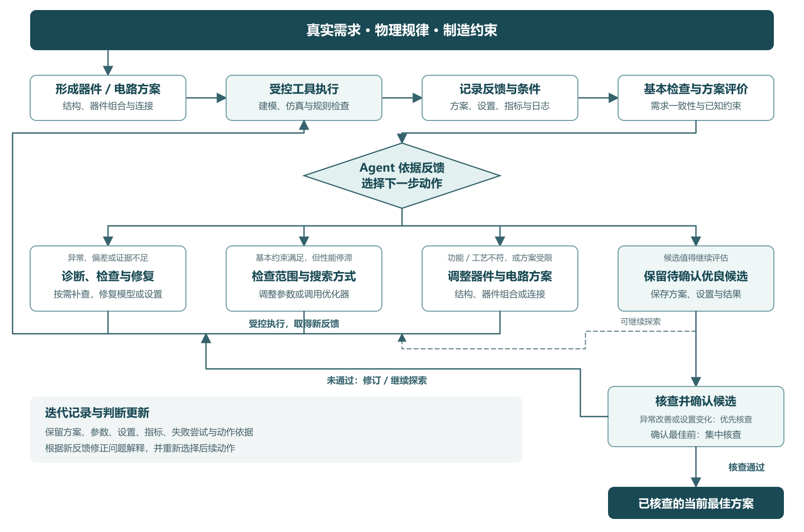

# 第三章｜仿真与验证反馈如何转化为设计决策

2026-10-15 修订稿

可靠的器件与电路设计，需要将需求、物理依据和制造约束与仿真、验证反馈联系起来。Agent 得到结果之后，要判断当前方案是否实现目标、问题来自哪里，以及应该修复模型或设置、调整参数，还是更换结构或电路方案。本章围绕反馈记录、问题诊断、方案调整和结果确认分析这一过程。

图 3-1：需求与约束下的反馈驱动设计决策流程。Agent 选择方案与修复动作，受控工具执行，并依据新反馈继续修订或确认候选。[SVG 源图](../assets/feedback-guided-design-flow-v2.svg)。

## 3.1 如何反馈与对比结果

反馈需要与设计需求、模型、设置和执行记录一起理解。以波导弯曲损耗为例，一次结果涉及结构与材料、求解条件、指标提取方式，以及尺寸和工艺约束。电路任务还需要记录器件组合、连接与整体响应。Agent 要据此判断：当前结果是否对应需求，和此前结果能否比较，方案是否满足已知约束。

| 反馈内容 | 主要记录 | 支持的判断 |
|---|---|---|
| 需求与评价依据 | 目标功能、工作条件、性能要求、已知制造规则及来源 | 当前方案需要满足什么，哪些要求尚未明确 |
| 设计与求解条件 | 几何尺寸、材料、器件模型、端口和连接、波长、网格、仿真时长、边界及配置版本 | 模型是否对应需求，哪些条件发生了变化 |
| 执行与提取记录 | 脚本、求解器日志、错误信息、结果文件与提取方法 | 工具是否完成执行，指标来自哪个输出 |
| 功能、性能与诊断产物 | 损耗、透射率、电路响应，以及相关场分布、模式或频谱 | 器件或组合后的电路是否达到目标，哪些现象需要进一步分析 |
| 约束检查记录 | 已检查的几何、工艺和连接规则，违规项及未核查项目 | 哪些候选需要修订，哪些约束仍缺少判断依据 |
| 迭代历史 | 修改内容、修改理由、前后结果、保留或回退记录 | 哪些尝试有效，当前判断适用于什么条件 |

电路评价关注器件组合之后是否实现目标功能。器件模型、端口连接与整体响应应共同进入检查；单个器件的性能改善，还需要放回所采用的电路方案中评价。制造要求则应以实际可取得的规则为依据，记录已经检查和仍待核查的内容。

Lumi 将执行成功、设置正确和结果正确分开评价。其 Fig.2(c) 中，用户要求的衬底截面为 2 μm × 2 μm，生成模型却为 2 μm × 1 μm，仿真仍能运行。[1] 这类偏差应先通过需求与模型字段核对处理，而不是直接将结果用于评价所请求的设计。

HALO 将保存的输出转换为数值指标，再生成诊断说明；同一次运行内固定复用评价脚本，诊断说明还由光学专家检查。[2] 这一做法将指标计算与文字解释分开。Agent 可以利用解释提出动作，性能判断仍需回到对应输出和评价计算。

可比性还涉及探索条件。AutoPhotonicDesign 的 RF 分支允许探索时将有限结构的周期数从 20 改为 10，以降低计算开销，但要求最终最好方案恢复到 20 后与基线比较。[3] 周期数改变的是被仿真的结构长度，并非仅调整网格。记录这种变化，才能判断探索中的改善是否足以支持最终方案选择。

## 3.2 问题诊断与模型、设置修复

方案不符合预期时，我倾向于
1️⃣区分执行问题、需求或模型偏差、物理与数值问题，以及功能或制造约束问题
2️再选择具体动作。

| 问题 | 优先分析 | 相应动作 |
|---|---|---|
| 工具报错、输出缺失或提取失败 | 调用参数、接口、文件和结果读取过程 | 通过受控工具修复执行或提取问题 |
| 尺寸、材料、连接或求解条件与需求不符 | 需求字段与实际模型、设置的对应关系 | 修正偏差，重新取得对应需求的结果 |
| 执行完成，但功能或性能不达标、结果变化异常 | 数值与提取条件、器件或电路响应、方案和历史趋势 | 补充诊断，再决定修复模型、设置或调整方案 |
| 性能改善，但违反给定制造规则 | 违规项、设计表示与规则适用范围 | 选择合规修订或替代方案，保留违规记录 |

当前采用基本检查与按需深入检查相结合的方式。每轮保留需求、配置、执行状态和已知规则等基本核对；出现异常、停滞或准备确认最佳方案时，再开展深入检查。以此减少不必要的检查开销，同时保留关键判断依据。

多个原因同时可能成立时，检查优先级为：原因的可能性>误判的风险>检查成本。可能性依据当前记录、条件变化、可比的历史结果和物理解释判断。每个主要假设需要指出支持它的反馈、仍然存在的其他解释，以及什么检查结果会改变当前判断。

原因尚未证实时，Agent 可以基于候选解释采取有依据、受控且可回退的尝试。行动前说明希望观察到什么变化，行动后用新反馈更新判断。某次修改改善了结果，可以支持继续考察该动作；根因解释是否成立，还需要对应证据。

现有工具范围内的问题由 Agent 自主处理。需要改变关键建模假设、多次检查仍无法解释结果、证据持续冲突或工具能力不足时，请专家介入。交接内容包括设计需求、当前方案、异常表现、候选原因、已尝试动作及结果，以及需要专家判断的问题。

物理解释与问题解决也需要区分。AutoPhotonicDesign 的多物理 MZM 案例中，Agent 提出了模式识别和结导纳重复计入两个问题；专家修复时还补充了端口对称性、网格细化和结参数等设置修正。[4] 这个案例说明诊断可以帮助推进流程，也显示最终修复可能依赖 Agent 尚未识别的条件。选择修复动作后，仍需检查新结果是否支持原判断。

## 3.3 参数调整与器件、电路方案选择

方案选择首先服务于需求与约束。功能要求或给定制造规则已经否定当前方案时，Agent 应优先分析可满足约束的器件结构、组合与连接替代方案。对满足基本约束、模型和设置经过相应核查但性能仍然停滞的方案，再分析搜索是否受限。

连续几轮没有改善提供了停滞线索，却不能单独说明当前设计已经没有改进空间。

AutoPhotonicDesign 的波导日志记录：在固定曲率参数及邻近宽度尝试中，透射率停留在约 0.9322；之后引入向内偏移，并进一步联合调整宽度与偏移，后期方案达到 0.9751。[5] 这说明，原来的局部停滞没有排除其他参数方向的改善。日志提出的机理解释和参数关系，仍需结合相应条件理解。

对于这类性能停滞，本报告采用以下分析顺序：

1. 检查参数范围：已有尝试是否集中在较窄范围，当前允许范围内是否仍有值得探索的方向。
2. 检查搜索方式：是否只逐个改变参数，是否忽略参数组合，以及已有优化方法是否适合当前问题。
3. 考虑设计思路：如果当前参数化难以表达新的改进方向，再分析更换器件结构、设计家族或组合方案的依据。

前两项主要改变搜索方式，第三项改变设计思路。器件任务可以调整结构形式；电路任务可以重新选择器件、连接方案或相应参数。Agent 需要说明替代方案如何响应原需求、哪些物理依据支持这一选择，以及如何检查制造约束。具体计算和规则核对由已支持的工具执行；新方案需要额外能力时，由人参与补充与检查。

RF 电极案例已经展示设计家族切换。作者报告 Agent 交错探索五类拓扑，在日志反映当前家族停滞时转向，并记录停滞指标和新家族预期解决的机制。[4]

值得进一步研究的是方案调整的依据与后果：哪些需求、约束或反馈支持现在调整，为什么当前方案难以满足目标，新方案预计改变什么响应。执行之后，再根据结果保留、修改或撤回原判断。这样将设计意图、物理解释与可检查的方案结果联系起来。

## 3.4 候选保留与结果确认

探索过程中得到较好的性能或功能表现，可以先保留为待确认的优良候选。若改善异常或伴随仿真设置变化，优先检查；其他候选可继续探索，在确认最佳方案前集中核查。方案确认综合考虑需求达成、物理与数值依据、结果可比性和已知制造约束，而不是仅比较单个指标的大小。

方案确认先检查必需条件，再比较可优化指标。需求中已经明确的必需功能、工作条件和制造规则，是确认合格方案的前提；通过这些检查的方案，再依据需求中的优先级权衡性能、面积等指标。已明确的制造违规不能用性能改善抵消，尚未核查的条件也不记为通过。若方案各有优势而需求没有给出取舍依据，应先明确优先级，再确认当前最佳方案。

| 方案状态 | 可以如何使用 | 需要明确的内容 |
|---|---|---|
| 待确认的优良候选 | 保存器件或电路方案、设置与结果，作为进一步探索和核查的对象 | 功能或性能改善依据、条件变化和待检查问题 |
| 已核查的当前最佳方案 | 在已核查的需求、评价条件与规则范围内，作为后续比较和回退参考 | 目标达成、物理与数值依据、约束检查结果 |

现有代码已经具备保留和回退支持。RF 分支的 `promote_best` 检查 FOM 是否为可处理数值，再与历史最好值比较；定向核读的晋升及历史最好值函数内部没有按仿真配置筛选记录。[6] 与之对应，作者指令已要求最终恢复基线条件。[3] 因此，方案确认需要把数值比较与配置条件结合起来；单看一个晋升函数还不足以判断整个运行是否正确完成了这一过程。

已经识别出违反给定制造规则的方案，应转入修订或替代方案分析，不作为满足约束的最佳方案。工艺规则检查、电路连接与功能评价、物理仿真以及制造签核分别记录，缺少证据的项目保留待核查状态。

候选未被采用或需要回退时，仍应保存它的方案、参数、结果及判断依据。失败记录帮助分析哪些修改没有奏效，也有助于重新审视此前的局部经验。Agent 根据后续反馈更新判断，设计过程便不只是反复尝试参数，而是逐步调整问题解释、设计方案和动作选择。

本章形成的主线是：将需求、物理依据和制造约束落实到评价，记录仿真与验证反馈，在受控工具范围内选择方案调整、优化或修复动作，再用后续结果检查判断，并区分候选探索与方案确认。第四章将在这些已有能力和具体困难的基础上，进一步讨论 H1、H2、H3 及当前研究缺口。

## 参考文献与原文定位

1. Chen 等，Lumi Agent，[DOI 10.1145/3787109.3816402](https://doi.org/10.1145/3787109.3816402)。用户提供 PDF p.4–5，§3.4、§4.3–4.4、Fig.2(c)、Table 2；身份与哈希见[证据索引](../evidence-index.md)。
2. Zhang 等，[HALO: A Physics-Aware LLM Agent Framework for Nanophotonic Design](https://arxiv.org/html/2608.28877v2)，Method / HALO Workflow、Common Evaluation Protocol。
3. AutoPhotonicDesign，RF 固定提交 `6d0e257b73579a331cc994b6973085ff512396c4`，[program.md，第 297–302 行](https://github.com/flexcompute/autophotonicdesign/blob/6d0e257b73579a331cc994b6973085ff512396c4/program.md#L297)，探索周期数与最终条件要求。
4. Kharel 等，[Autonomous agentic design for photonics](https://arxiv.org/html/2606.00915v1)，§3.3、§S4.3、§S6。本文按作者报告引用案例，未重算其物理结果。
5. AutoPhotonicDesign，bend 固定提交 `280973d197643054ba0ab414e6a5e62b1ee8256d`，[output/journal.md，第 113–154 行](https://github.com/flexcompute/autophotonicdesign/blob/280973d197643054ba0ab414e6a5e62b1ee8256d/output/journal.md#L113)，局部停滞、偏移与联合搜索记录。
6. AutoPhotonicDesign，同 RF 固定提交，[tools/journal.py，第 160–178 行](https://github.com/flexcompute/autophotonicdesign/blob/6d0e257b73579a331cc994b6973085ff512396c4/tools/journal.py#L160)及[第 280–296 行](https://github.com/flexcompute/autophotonicdesign/blob/6d0e257b73579a331cc994b6973085ff512396c4/tools/journal.py#L280)，晋升和历史最好值函数；为源码静态核读。

事实、作者解释与本报告分析的对应见[决策证据卡](../feedback-decision-evidence-cards.md)。写作取向见[第三章讨论记录](03-discussion-notes.md)；辅助综述与审查工具出处沿用[证据索引的方法说明](../evidence-index.md#审查方法说明)。
