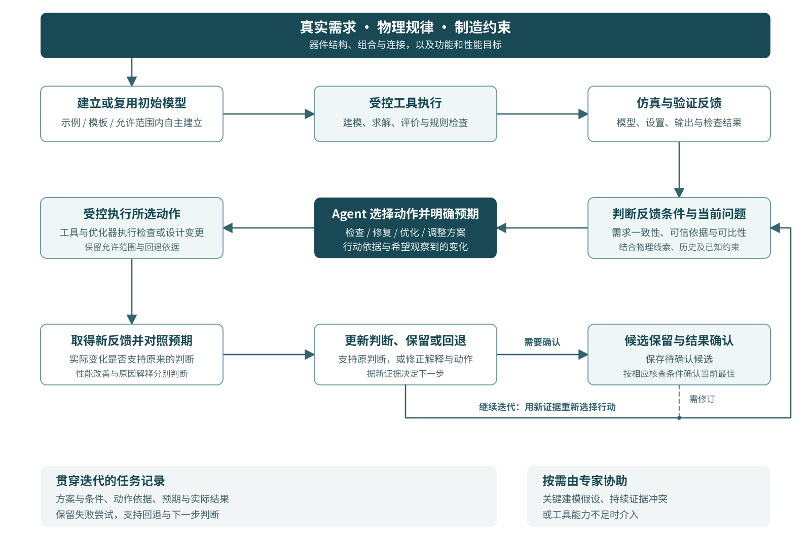

# 第五章｜候选切入口与初步方案

2026-10-15 讨论初版

## 5.1 研究问题：反馈条件下的设计行动选择与修正

优先考虑的切入口是：在真实需求、物理规律和制造约束下，Agent 如何利用仿真与验证反馈，在修复模型或设置、继续优化和改变设计方案之间作出合理选择，并通过后续结果修正判断。

这个问题可以进一步集中到三类情境：
1️⃣结果异常，当前反馈尚不足以支持性能判断；求解或评价条件变化，新的改善需要重新理解；
2️⃣性能停滞，需要区分搜索不足   3️⃣当前方案受限
它们共同涉及“已有反馈支持采取什么行动”。

器件层面涉及结构与参数选择；电路层面涉及器件组合、连接关系与整体功能响应。需求和已知制造约束构成行动边界，仿真与验证提供判断依据，Agent 负责协调下一步设计动作。

## 5.2 初步方法：将反馈条件、行动依据与后续观察联系起来

### 5.2.1 判断反馈能够支持什么

一次运行完成后，先保留需求、当前模型、求解设置、执行状态、评价结果和已知规则检查。明确的字段偏差、工具错误和制造违规优先通过确定性检查处理；其余问题结合物理表现与迭代历史分析。

反馈不能只用“成功/失败”概括。改变计算条件后得到的较优结果，可以支持保留探索候选，但是否足以替换已确认方案，需要比较相应条件。AutoPhotonicDesign 的 RF 指令已经区分探索周期数与最终比较条件，为这种区分提供了可借鉴的基础。[1] 

基本核对每轮保留，深入检查按需触发。对没有明显异常、条件可比的结果，可以继续探索；异常改善、设置变化或最佳方案确认时，再优先补充核查。需要哪些检查，由实际问题及现有工具能力决定。

### 5.2.2 根据证据选择优先动作

Agent 结合当前需求、物理线索、搜索记录与约束，提出优先动作及必要的备选，并说明：哪些反馈支持这一选择，哪些条件仍不明确，以及预期通过行动获得什么变化或信息。

| 当前情境 | 优先考虑的动作 | 决策需要说明的依据 |
|---|---|---|
| 明确的需求偏差、执行错误或已知规则违规 | 修复模型、调用或合规性问题 | 偏差位置、适用要求及允许的修改范围 |
| 反馈异常或评价条件变化 | 补充检查，或修复求解、提取设置 | 异常表现、条件差异，以及检查将帮助区分什么 |
| 结果具备相应可信依据，但性能停滞 | 检查参数范围与搜索方式，再考虑方案调整 | 已尝试范围、仍未探索的方向、替代方案的物理依据 |
| 获得较优结果 | 保留待确认候选，按需要继续探索或核查 | 改善是否可比、必需条件是否满足、尚待确认的项目 |

这些情境可以并存。多种原因同时可能成立时，沿用原因可能性、误判风险和检查成本的优先次序；原因尚未证实时，也可以选择有依据、受控且可回退的尝试。已明确的违规不能因性能改善而被忽略。

对于局部停滞，判断应保留适用条件。如波导弯曲的公开日志中原先邻近参数中的停滞，后来仍能通过其他参数方向和联合调整打破。[2] 因此，“连续没有改善”需要与参数范围、搜索方式及当前参数化一起理解，再决定是否改变设计思路。

### 5.2.3 用后续反馈修正判断

重要行动执行后，将实际结果与预期观察对照。符合预期时，可以支持继续考察该方案；未改善、出现新异常或触犯约束时，则修改解释、撤回动作或选择其他路径。性能改善与原因解释的可信程度分别判断。

这里只保存简短的决策链：当前观察、候选解释、选择动作、预期变化、实际结果，以及下一步判断。任务历史中的失败参数和结果也保留，避免将特定条件下的经验直接扩展为普遍规律。

这一机制的目的，是让新反馈实际改变后续行动。跨任务长期记忆与持续进化保留为待研究观点；本方案先利用当前任务内的记录支持设计推进。

## 5.3 概念流程与职责分工

初步流程可以组织为：

> 需求与约束 → 建立或复用初始模型 → 受控工具执行 → 仿真与验证反馈 → 判断反馈条件和当前问题 → 选择检查、修复、优化或方案调整 → 执行并对照预期 → 更新判断、保留或回退。

图 5-1：反馈驱动的器件与电路设计概念流程。行动执行后，将新反馈与预期对照，更新判断并进入下一轮；候选按相应核查条件确认。[PNG 预览](../assets/candidate-design-decision-flow.png) · [SVG 源图](../assets/candidate-design-decision-flow.svg)。

初始模型可以来自已验证示例、模板或 Agent 在允许范围内的自主建立。反馈既用于调整参数，也用于判断模型是否偏离需求、器件组合与连接是否合适、方案是否满足功能和已知制造要求。现有工具不足以表达新结构或计算能力时，由人参与扩展与检查。

| 部分 | 主要职责 | 可借鉴的已有基础 |
|---|---|---|
| 需求与设计表示 | 保存功能、工作条件、尺寸材料、连接及约束，支持逐项核对 | 前文讨论的结构化表示、示例与模板 |
| Agent 决策 | 综合证据，选择方案、检查、优化或修复动作，提出预期观察 | AutoPhotonicDesign 的迭代与策略调整经验[3] |
| 受控工具与优化器 | 执行建模、仿真、搜索、指标计算及明确规则检查 | HALO 的结构化工具边界，以及可调用的确定性工具[4] |
| 反馈与任务记录 | 关联模型、设置、输出、修改与结果，支持候选保留和回退 | Lumi 的产物归档、AutoPhotonicDesign 的日志与回退支持[1,5] |
| 专家协助 | 处理关键建模假设、持续证据冲突和工具能力不足 | 已讨论的人参与工具扩展及结果判断方式 |

这些基础提供的是组织参考，具体求解器、优化方法和器件模型尚待选择。电路功能评价、物理仿真、几何或工艺规则检查分别提供相应证据；GDS 生成、DRC 通过与完整制造签核不能合并为一个“设计成功”状态。

## 5.4 与已有方法的联系及拟改进之处

现有工作已展示反思、错误修复、设计家族切换和记录保留。[3–5] 本方案不把这些动作本身作为主要差异，而将改进重点放在它们之间的选择与反馈修正：

1. 将反馈条件与行动用途联系起来。哪些结果可以继续探索，哪些需要先检查，哪些足以支持确认改进，应影响下一步选择。
2. 将停滞判断与搜索范围、参数化及物理线索联系起来，减少仅凭指标未改善就换方案的判断。
3. 将动作依据与可核查预期联系起来，使后续结果能够支持、修订或撤回原判断。

这三点共同服务于自主设计推进，证据记录是其支撑。拟改进之处仍需与现有系统的完整决策机制和原始轨迹进一步核对；当前可以明确的是候选机制与比较对象，尚不能据此确认新颖性或效果。

更简单的替代方案是固定检查表、明确错误路由、优化器停止条件和预设多方案搜索。对规则已经足够的问题，直接采用规则；Agent 重点处理证据需要综合、动作之间存在取舍的部分。由此避免将所有检查都交给语言模型，也避免为已有自动化额外增加复杂决策层。

## 5.5 候选方向比较

沿用已有比较，其他切口作为收窄选择简要保留。

| 候选切口 | 主要解决什么 | 主要局限 |
|---|---|---|
| 反馈条件下的设计行动选择与修正 | 协调检查、修复、优化与器件/电路方案调整 | 容易范围过宽，需围绕异常、条件变化和停滞等明确情境收敛 |
| 性能停滞后的策略切换 | 判断继续搜索还是改变参数化或设计家族 | 已有工作覆盖较多，容易将搜索不足误判为方案瓶颈 |
| 模型与仿真设置修复 | 减少需求偏差、执行与求解设置问题 | 单独开展时可能偏离自主设计决策，固定规则和官方检查也可能足够 |

优先讨论第一项，是因为它保留了 Agent 自主推进设计的目标，也能把后两项作为具体动作纳入，而不将课题缩成单一报错修复或参数优化。

主要风险有三个：第一，已有框架可能已能完成相近功能，改进需要落到具体决策机制；第二，物理解释可能错误，数值改善也可能受到条件变化影响，需要依靠工具输出和后续观察约束判断；第三，过多检查可能阻碍探索，应坚持基本核对与按需深入检查。最终需要讨论的是哪些决策由 Agent 承担确有必要，以及方法在器件和电路任务中如何保持清楚的适用范围。

## 参考文献与证据定位

1. AutoPhotonicDesign，RF 固定提交 `6d0e257b73579a331cc994b6973085ff512396c4`，[program.md，第 297–302 行](https://github.com/flexcompute/autophotonicdesign/blob/6d0e257b73579a331cc994b6973085ff512396c4/program.md#L297)，探索与最终评价条件；[tools/journal.py](https://github.com/flexcompute/autophotonicdesign/blob/6d0e257b73579a331cc994b6973085ff512396c4/tools/journal.py)，归档、保留与回退。静态核读边界见[证据卡 1](../feedback-decision-evidence-cards.md)。
2. AutoPhotonicDesign，bend 固定提交 `280973d197643054ba0ab414e6a5e62b1ee8256d`，[output/journal.md，第 113–154 行](https://github.com/flexcompute/autophotonicdesign/blob/280973d197643054ba0ab414e6a5e62b1ee8256d/output/journal.md#L113)，局部停滞与后续联合调整，沿用既有源码记录核读。
3. Kharel 等，[Autonomous agentic design for photonics](https://arxiv.org/html/2606.00915v1)，§2、§S4.3、§S6，流程组织、策略调整与人机纠错；作者结果未由本项目复算。
4. Zhang 等，[HALO: A Physics-Aware LLM Agent Framework for Nanophotonic Design](https://arxiv.org/html/2608.28877v2)，Planner Configurations、Common Evaluation Protocol，结构化执行边界与反馈评价。
5. Chen 等，Lumi Agent，[DOI 10.1145/3787109.3816402](https://doi.org/10.1145/3787109.3816402)，用户提供 PDF §3.4，产物归档；身份及已有核读见[证据索引 E2](../evidence-index.md)。

已有证据与候选方法的区分见[决策证据卡](../feedback-decision-evidence-cards.md)和[第四章](04-gaps-and-hypothesis-judgments.md)。本章为基于前文提出的初步方案，讨论进展见[第五章讨论记录](05-discussion-notes.md)；辅助方法出处沿用[证据索引](../evidence-index.md#审查方法说明)。
