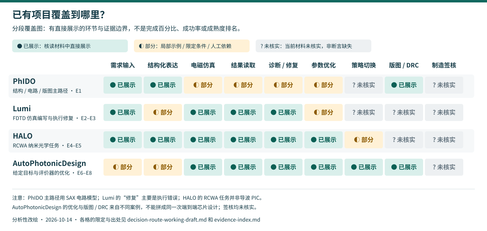

# 仿真反馈如何支持 Agent 继续优化：路径比较与初步方案

日期：2026-10-14 · `WORKING DRAFT`。供研究者核读、修改与判断，不是最终报告。

## 1. 当前问题与范围

`USER CONFIRMED`：**Agent 如何依据仿真反馈，合理选择修复设置、继续调参或改变策略，使优化更可靠地继续推进？**

自主性首先体现在优化过程中的动作选择，而不只是生成代码或把日志交给专家。保留失败参数、结果和选择理由，有助于后续判断，但记录更多不等于决策更正确。DAS 仅作背景，完整芯片签核不是本轮目标。跨任务长期记忆列为待研究，不进入主方案。

本文标记：`FACT` 为可定位的材料内容；`AUTHOR CLAIM` 为作者报告的性能或能力；`CODE INSPECTED` 为固定版本只读源码观察，**不表示实际运行**；`INFERENCE` 为助手的分析建议；`UNKNOWN` 为当前证据不足。每项 E 编号对应[证据索引](evidence-index.md)。

## 2. 已有项目覆盖范围


图例：● 该环节在核读材料中有直接展示；◐ 部分、限定场景或依赖人工；? 当前未核实。● 不表示成功率 100%、物理正确或工程成熟。? 不表示项目绝对没有该能力。分段之间不表示必须线性执行；诊断和优化会回到仿真。图为助手依据 E1–E8 的分析性改绘。

| 项目 | 需求 | 结构化表达 | 电磁仿真 | 结果读取 | 诊断/修复 | 参数优化 | 策略切换 | 版图/DRC | 制造签核 |
|---|---|---|---|---|---|---|---|---|---|
| PhIDO（论文主路径） | ● | ● | ◐ | ◐ | ◐ | ◐ | ? | ● | ? |
| Lumi | ● | ◐ | ● | ● | ● | ◐ | ? | ? | ? |
| HALO | ● | ● | ● | ● | ● | ● | ◐ | ? | ? |
| AutoPhotonicDesign | ◐ | ◐ | ● | ● | ● | ● | ● | ● | ? |

**不能跨项目直接比较成功率。** PhIDO 主评测关注 schematic/GDS 有效性；Lumi 关注仿真脚本执行及专家评审；HALO 关注纳米光学任务中的结构化建模与电磁执行；AutoPhotonicDesign 展示工程师定义的问题与评价器下的自主优化。输入、工具、预算和成功定义不同。依据 E1–E6，`INFERENCE`。

图中几个容易误读的边界：

- PhIDO 的电磁仿真只标部分：主路径是 SAX 电路模型与版图，不能把局部 FDTD 示例解释为通用全波优化；诊断/修复主要指结构或路由，不是通用物理根因分析（E1）。
- Lumi 的修复直接展示执行错误反思与重试，不能因此认定它已可靠判断器件物理。结构化计划/脚本不等于经过 typed schema（类型化规范）验证的 DesignSpec（E2–E3）。
- HALO 用 RCWA 电磁求解；其周期纳米结构任务与导波 PIC 不同。设计修订不自动等于跨拓扑优化策略管理，故策略切换标部分（E4–E5）。
- AutoPhotonicDesign 从人类设定的目标、初始脚本和评价器出发；不是完整自然语言到通用类型化规范。版图/DRC 和优化来自不同案例，不能拼成同一次完整芯片设计（E6–E8）。
- 所有项目均没有在本工作稿核实 foundry signoff（代工厂签核）证据。

## 3. 已有三种路径，怎么借鉴

| 路径 | 代表与实际机制 | 适合借鉴的部分 | 对当前问题的限制 |
|---|---|---|---|
| 自主编码与反思 | Lumi：写脚本、运行 Lumerical、分析执行反馈；AutoPhotonicDesign：可编辑设计脚本、定量结果、探索/回退 | 灵活调用工具、保留失败、快速尝试现成器件方案 | API/代码/输出错误会与器件性能失败混在一起；缺少独立证据不能接受物理解释（E2–E3、E6–E7） |
| 固定结构化工作流 | HALO 固定配置：LangGraph、提示生成结构化输出、Pydantic 检查、受限工具边界 | 用确定性检查处理尺寸/材料字段和调用契约，减少无关失败 | 固定流程可能限制动作空间；schema 通过不能证明材料模型、网格和结果可信（E4–E5） |
| 自主结构化 Agent | HALO 自主结构化配置：LangChain DeepAgent，可规划和使用工作区，正式 RCWA 调用仍走结构化接口 | 将自主决策与确定性求解边界分离 | 不保证优于固定工作流；自主性仍可能增加无效输出、超时或运行错误（E4–E5） |

`INFERENCE / 初步推荐`：以**自主结构化 Agent**作为候选载体，同时保留规则、参数扫描和优化器作为底层执行机制。集中讨论仿真后的三类动作，而不是重新搭建通用 Harness 或把所有流程都交给 LLM。

这不是最终选型，也不是已证明最优：HALO 的配置比较不支持“越自主越好”；AutoPhotonicDesign 表明自主编码也可以产生有效优化。商业或开源求解器的适配与成本尚未确定，不能承诺已经具备实施条件。

## 4. 三类动作需要什么依据

以下为 `INFERENCE / 拟议方法边界`，没有实现、没有收益测量，不给定实验预算或数值阈值。

| 动作 | 合理的触发线索 | 决策前需要区分 | 必须避免 |
|---|---|---|---|
| 修复设置 | 需求与模型尺寸/材料不一致；代码/API/提取异常；结果对网格、时长等条件敏感 | 执行失败、需求偏差、数值不可信分别是什么；修复是否改变评价条件 | 一看到损耗高就改器件；或通过修改目标、评价公式获得“达标” |
| 继续调参 | 结果可用且条件一致；存在值得继续探索的参数响应 | 有效趋势、参数耦合与数值波动；已有失败是否排除或仅限制某一区间 | 多参数一起变后，就独立归因给某一参数 |
| 改变策略 | 反馈可信，但当前方案持续受限；有对下一方案的条件性依据 | 搜索不足、数值平台、设计家族瓶颈是否可区分；替代方案适用条件 | 一次不达标就宣布平台期或全局最优；无依据增加复杂拓扑 |

辅助动作是获取诊断证据、回退或请求专家，不需要再扩展成第四个研究方向。**缺乏证据时不强行三选一。**

### 拟议的最小决策链

```text
当前设计 + 求解器配置 + 实际执行产物 + 当前任务历史
  → 核对需求/执行/评价条件
  → 判断反馈是否足以支持比较
  → 形成原因假设、下一步动作与预期影响
  → 修复设置 / 继续调参 / 改变策略
  → 工具执行、重新评价、保留或回退
```

值得进一步明确的窄问题是：**当仿真条件或结构家族可能变化时，Agent 如何避免依据不可比较的结果，做出错误的保留、回退或策略切换？** 这是对主问题的细化建议，不替换用户已确认的表述，也尚不能宣称新颖。

若修改网格、时长或提取设置，前后 FOM（性能指标）可能不再直接可比；宜先判断改变影响，必要时在一致条件下复评参考设计，再比较改进。AutoPhotonicDesign RF 分支已有恢复最终评价条件的要求（E7），所以“保持比较条件一致”本身不是新发明。可继续研究的空间在于何时检查、依据是否充分，以及动作能否帮助自主优化继续推进。

## 5. 用波导弯曲案例检验理解

**作者实际展示（E6、E8）**：AutoPhotonicDesign 在规定 SiN 平台、波长、弯曲半径和约束下，探索弯曲曲率、宽度变化与偏移；作者报告弯曲损耗从 0.460 dB 降到 0.109 dB。它是特定条件下找到的最好结果，不是已证全局最优，更不是本项目的实验。

该案例提醒我们：

1. **尺寸错误应先用最简单的确定性核对。** Lumi E1 请求的衬底高度与生成模型不一致，即使仿真正常执行，也没有完成该需求（E3）。不必为每个字段偏差增加物理推理 Agent。
2. **性能不达标不等于器件设计错。** 先排除工具执行、材料赋值、模型与数值设置的可疑处；但没有证据也不能把高损耗全部归因于网格。
3. **一次参数尝试只支持局部判断。** bend 日志早期宽度比 1.5 未改善，后来在不同曲率与偏移下更宽方案反而较好。早期“过宽导致多模”的日志解释不能变成跨条件定律（E8）。
4. **改善不证明解释正确。** 参数响应、物理机理与动作有效性是不同问题；有日志可核查，也仍可能记录错误的原因故事。

`USER CONFIRMED`：已有方案可以借鉴，但应分析条件差异；失败尝试要保留，用来理解参数变化与性能的关系。`INFERENCE`：这些记录先服务当前自主优化，不自动证明模型进行了长期学习。

## 6. H1 / H2 / H3：更新判断，而非把 UNKNOWN 强行填满

| 旧问题 | 本轮初判 | 支持与反例 | 仍需保留的未知 |
|---|---|---|---|
| H1：现有 PIC Agent 是否缺少物理诊断与决策？ | **“普遍没有”不成立。** 已有诊断、纠错、数值反馈和策略切换实例 | Lumi 的反思；HALO 的诊断评价；AutoPhotonicDesign 的假设修订、拓扑切换及 MZM 人机纠错（E2、E4、E6） | 跨器件诊断覆盖、根因正确性和自主决策可靠性；不能从几个案例推出已经通用 |
| H2：物理引导推理能否改善设计与可靠性？ | **独立增益仍 UNKNOWN。** 有闭环结果，不等于因果归属于物理推理 | HALO 配置同时改变工作流和工具自由度；AutoPhotonicDesign 同时含物理先验、搜索与工程检查（E5–E7） | 推理相对于规则/优化器的额外作用；错误解释或额外调用是否抵消收益 |
| H3：相对优化/逆设计，Agent 增加什么？ | **条件性价值，而非天然优势。** 候选是设置修复与搜索策略之间的协调 | 数值优化已能搜索参数/自由形状；AutoPhotonicDesign 也已有协调机制（E6–E9） | 固定规则加优化器是否足够；复杂动作选择何时真正需要 Agent |

H1 的宽泛前提应修正；H2/H3 的未知被明确为“缺少哪种证据”，而不是用个人判断制造效果结论。工程改进可以作为候选贡献，但不因此免除与已有工作的对比。

## 7. 初步方案与替代路线

2026-10-14 补核：详见[三张决策证据卡](feedback-decision-evidence-cards.md)。RF 指令已有恢复正式评价条件的要求，但所核读 `promote_best` / `_current_best_fom` 函数内部只比较 FOM，没有按评价条件筛选。**尚未证实实际出现错误晋升，不能据此宣布全系统缺陷。** bend 轨迹也显示局部平台可被另一参数方向打破，不等于 Agent 完全不会选择策略。

**候选方案（助手建议，待用户审查）**：将反馈的可用性检查、当前搜索状态和三类动作选择连接起来。Agent 负责提出原因假设及动作；确定性工具负责字段核对、数值计算和约束检查；任务历史保留失败、设置变化与当前最好设计。专家在证据不足或超出边界时介入，而不是替 Agent 执行每一步。

| 候选切口 | 可以利用的基础 | 主要风险 | 更简单替代 |
|---|---|---|---|
| 反馈可信度引导的动作选择（优先讨论） | HALO 类型化调用、Lumi 反思产物、AutoPhotonicDesign 搜索/回退 | 改进可能只是已有规则的整理；不能证明诊断正确或泛化 | 固定检查表 + 明确错误路由 + 参数优化器 |
| 平台期后的策略切换（次选） | AutoPhotonicDesign 拓扑切换、任务历史 | 平台期易被数值波动或搜索不足误判；既有工作覆盖较多 | 预先规定的多家族搜索/贝叶斯优化 |
| 单纯数值设置修复（保守备选） | Lumi 执行修复及专家检查 | 容易停留于错误处理，离器件自主优化目标较远 | 求解器官方检查、模板和收敛流程 |

当前不同时开展三条方法。初步建议先用第一项组织报告，后两项作为比较与收窄备选；它们不构成最终定题或已经证实的创新。

候选方法进一步收窄为三点：区分“探索结果 / 确认改进”；让平台期判断带有参数范围和反馈条件；让重要动作附具体证据与预期影响，并接受后续反馈修正。它们服务于自主优化的动作选择，不把审计材料当最终目标。若固定规则与优化器足够，优先采用，不强制增加 Agent 模块。`INFERENCE`，未实现、未证明有效性或新颖性。

团队信息仅按用户陈述保留：李师兄可指导器件物理与结果判断；软件、模块或开源求解器之后确定；实验室有流片条件并希望争取。尚未核实具体 PDK、费用、模型、排期和支持范围，不据此认定路线已可实施。本报告不做资源匹配、实验方案或流片承诺。

## 8. 待研究观点：跨任务经验复用

用户提出从成功/失败复盘进入长期记忆，帮助后续器件任务，而不只服务当前设计。该观点保留为 `DEFERRED`。当前任务内日志已有先例，不能等同于跨任务持续进化；经验适用条件、错误经验清理和迁移证据之后另行讨论。本轮不继续展开，不把它写成主方案。

## 9. 接回报告流程

**本次已形成**：四项目分段覆盖、三路径比较、三类动作所需依据、H1–H3 初判和窄切口建议。还不是正式报告。

接下来按顺序完成：

1. 已将“反馈可比较”及“平台期/切换依据”补成三张证据卡；之后只补会影响路线判断的材料，不继续扩充大候选池。
2. 由用户核读后调整推荐理由；缺少原文证据的部分维持 UNKNOWN，不要求用户凭直觉补结果。
3. 形成新报告：问题与范围 → 已有路线与覆盖图 → 代表工作证据 → H1–H3 → 初步候选方案与未决项。旧报告只引用，不拼接；报告行文由用户核心理解支撑。
4. 按本周末截止推进；计划 10-16 给可读初稿。正式 DOCX 的生成与核验放在内容稳定后，不能提前标记完成。

当前五个未决项：第一器件场景；反馈可信性的判定边界；平台期与搜索不足如何区分；策略切换相对规则/优化器的差异；论文补充材料与实际原始轨迹是否足以支撑诊断正确性。

这些是报告需要说清楚的研究问题，不是现在启动仿真或设计对照实验的授权。
